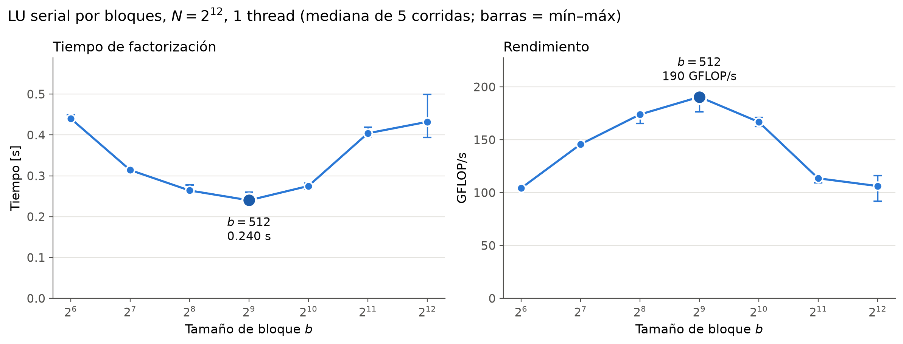
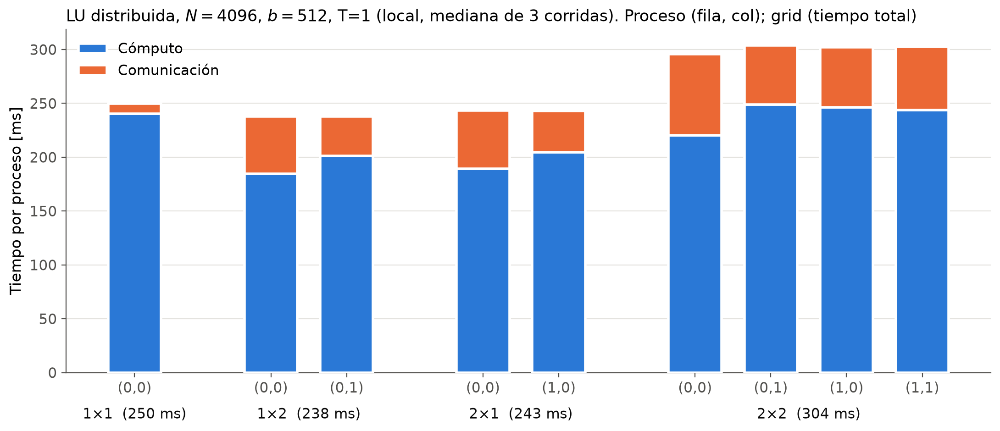

::: {#tab:hardware_config}
  **Característica**              **Computador usado (MacBook Air)**
  ------------------------------- ---------------------------------------------------------------------------
  **Sistema Operativo**           macOS 26.6.2 (arm64)
  **Procesador**                  Apple M2
  **Núcleos Físicos / Lógicos**   8 / 8 (4 P + 4 E)
  **Frecuencia máxima**           $\sim$`<!-- -->`{=html}3,49 GHz (P) / $\sim$`<!-- -->`{=html}2,42 GHz (E)
  **Memoria RAM**                 16 GB
  **Caché L1 (Instrucciones)**    192 KB (P) / 128 KB (E)
  **Caché L1 (Datos)**            128 KB (P) / 64 KB (E)
  **Caché L2**                    16 MB (P) / 4 MB (E), compartida por cluster
  **Caché L3**                    No tiene L3 clásico (caché de sistema SLC)
  **Python / NumPy / SciPy**      3.14.3 / 2.3.5 / 1.17.1.

  : Configuración de hardware y software utilizada para los
  experimentos.
:::

A continuación, los incisos (a) y (b) fueron llevados a cabo con el
Computador de la tabla anterior.

# (a) {#sec:inciso_a .unnumbered}

## Metodología {#metodología .unnumbered}

Se ejecutó `lu_serial.py` con $N = 2^{12} = 4096$ y tamaños de bloque
$b \in \{2^{12}, 2^{11}, \dots, 2^{6}\}$. En el computador usado, NumPy
y SciPy usan Apple Accelerate como implementación de BLAS/LAPACK.

Para restringir el cómputo a un thread se fijaron `OMP_NUM_THREADS`,
`OPENBLAS_NUM_THREADS` y `MKL_NUM_THREADS` en 1 y, además,
`VECLIB_MAXIMUM_THREADS=1`, que es la variable que controla Accelerate.
El barrido se automatizó con `run_a.sh`: cada valor de $b$ se ejecutó 5
veces en procesos independientes. El tiempo medido por el script
corresponde solo a la factorización (sin generar la matriz) y el
rendimiento se calcula como $\tfrac{2}{3}N^3 / t$. Se reporta la mediana
de las 5 corridas junto con el mínimo y el máximo, que son más robustos
que la media frente a corridas perturbadas por otros procesos del
sistema. La tabla y la figura se generan con `plot_a.py`.

Antes del barrido se verificó la factorización con la opción `--check`
($N = 1024$, $b = 128$), que entregó un residuo relativo
$\|A - LU\|_F / \|A\|_F = 4.2 \times 10^{-16}$, del orden del épsilon de
máquina.

## Resultados {#resultados .unnumbered}

El Cuadro  [2](#tab:a){reference-type="ref" reference="tab:a"} y la
Figura [1](#fig:a){reference-type="ref" reference="fig:a"} muestran el
tiempo y el rendimiento en función de $b$. La columna *Pasos*
corresponde al número de iteraciones $N/b$ del algoritmo por bloques.

::: {#tab:a}
        $b$   Pasos $N/b$   Mediana \[ms\]   Mín. \[ms\]   Máx. \[ms\]     GFLOP/s
  --------- ------------- ---------------- ------------- ------------- -----------
         64            64              440           436           449       104.2
        128            32              314           311           318       145.7
        256            16              264           263           277       173.9
    **512**         **8**          **240**       **238**       **260**   **190.5**
       1024             4              275           268           282       166.8
       2048             2              404           396           419       113.5
       4096             1              432           394           499       106.2

  : LU serial por bloques con $N = 4096$ y un thread: mediana, mínimo y
  máximo de 5 corridas por valor de $b$. En negrita, el $b$ de menor
  tiempo.
:::

<figure id="fig:a" data-latex-placement="h">

<figcaption>Tiempo de factorización (izquierda) y rendimiento en GFLOP/s
(derecha) en función de <em>b</em>, con
<em>N</em> = 4096 y un thread. Los
puntos son la mediana de 5 corridas y las barras, el rango
mínimo–máximo.</figcaption>
</figure>

El tiempo describe una curva en forma de U. El mínimo se alcanza en
$b = 512$, con 240 ms (190 GFLOP/s), lo que equivale a una aceleración
de $1.8\times$ respecto de $b = N = 4096$ (432 ms). Los valores vecinos
$b = 256$ y $b = 1024$ quedan a un 10% y un 15% del óptimo,
respectivamente. En los extremos, $b = 64$ y $b = 4096$ entregan tiempos
similares (440 y 432 ms), cerca de $1.8$ veces más lentos que el óptimo.
La variabilidad entre corridas es baja (rango menor al 10% de la
mediana), salvo en $b = 4096$, donde llega a un 24%.

## Análisis {#análisis .unnumbered}

En cada paso, el algoritmo realiza tres tipos de operación con
rendimientos muy distintos: la factorización del bloque diagonal
(`lu_factor`), las dos resoluciones triangulares de los paneles
(`solve_triangular`) y la actualización de la submatriz restante
(producto `@`). Sumando sobre los $N/b$ pasos, la fracción del total de
$\tfrac{2}{3}N^3$ operaciones que corresponde a cada una es
$$\underbrace{\left(\frac{b}{N}\right)^{2}}_{\text{bloque diagonal}}, \qquad
  \underbrace{\frac{3\,b\,(N-b)}{2N^{2}}}_{\text{paneles}}, \qquad
  \underbrace{1 - \left(\frac{b}{N}\right)^{2} - \frac{3\,b\,(N-b)}{2N^{2}}}_{\text{actualización}}.$$
Con $N = 4096$, la actualización concentra el 98% de las operaciones con
$b = 64$, el 82% con $b = 512$ y solo el 38% con $b = 2048$. Con
$b = 4096$ todo el trabajo recae en una única llamada a `lu_factor`
sobre la matriz completa.

#### $b$ grande.

Al aumentar $b$ se traslada trabajo desde la multiplicación de matrices,
que es la operación más eficiente, hacia `lu_factor` y
`solve_triangular`, que tienen más dependencias internas y rinden menos.
Como referencia, con $b = 512$ la instrumentación de `lu_distributed.py`
en un grid $1 \times 1$ (inciso (b)) mide 146 ms en la actualización y
81 ms en los paneles. Esto equivale a unos 260 GFLOP/s en el producto y
unos 90 GFLOP/s en las resoluciones triangulares: los paneles son el 16%
de las operaciones pero un tercio del tiempo. Con $b \geq 2048$ más de
la mitad de las operaciones cae en estas rutinas lentas, y por eso el
rendimiento baja a 106--114 GFLOP/s.

#### $b$ pequeño.

Con $b$ pequeño casi todo el trabajo es multiplicación de matrices, pero
de rango $b$: el producto $L_{ik}U_{kj}$ realiza $2n^2b$ operaciones
sobre una submatriz de $n^2$ entradas, por lo que su intensidad
aritmética es proporcional a $b$. Además, la submatriz restante se lee y
se escribe completa en cada paso. En total se recorren
$\sum_k (N - kb)^2 \approx N^3/(3b)$ entradas: unas $3.6 \times 10^{8}$
(2.9 GB por recorrido) con $b = 64$, frente a $4.5 \times 10^{7}$
(0.36 GB) con $b = 512$. Con $b$ pequeño la actualización queda entonces
limitada por el ancho de banda de memoria y no por la capacidad de
cómputo. El *overhead* del intérprete de Python por iteración es
despreciable en comparación: incluso con $b = 64$ son solo 64
iteraciones.

#### Elección de $b$.

El óptimo $b = 512$ equilibra ambos efectos: la actualización todavía
concentra el 82% de las operaciones y cada producto tiene rango
suficiente para operar cerca del máximo rendimiento del equipo. Se elige
$\mathbf{b = 512}$ para los experimentos siguientes. La curva es plana
alrededor del óptimo ($b = 256$ y $b = 1024$ quedan a menos de un 15%),
así que la elección no es crítica dentro de ese rango.

#### Limitaciones.

Los valores absolutos, cercanos a 190 GFLOP/s, son altos para un solo
núcleo. Esto se explica porque Accelerate ejecuta las operaciones
matriciales en el coprocesador matricial del M2 (AMX), compartido por el
grupo de núcleos de rendimiento. Se comprobó que con $b = 512$ los
tiempos con y sin `VECLIB_MAXIMUM_THREADS=1` son prácticamente iguales
(252--314 ms con la variable y 239--266 ms sin ella, en 3 corridas de
cada caso), por lo que limitar los threads no restringe del todo el
hardware que se usa. Así, el óptimo encontrado depende de la
arquitectura y de la biblioteca BLAS. Además, los dos efectos dependen
de $b$ de forma distinta: la fracción de trabajo que va a los paneles y
al bloque diagonal depende de la razón $b/N$, mientras que la intensidad
aritmética de la actualización depende de $b$ en términos absolutos. Por
eso no es evidente que $b = 512$ siga siendo óptimo en el *cluster* con
$N = 8192$ y otra biblioteca BLAS, lo que se evalúa en el inciso (c).

# (b) {#sec:inciso_b .unnumbered}

## Metodología {#metodología-1 .unnumbered}

#### Implementación.

`lu_distributed.py` recibe $N$, $b$, $p_r$ y $p_c$ (`--N`, `--b`,
`--pr`, `--pc`). Exige que $p_r p_c$ sea igual al número de procesos y
que $b$ divida a $N$. El grid y los comunicadores se construyen como
indica el enunciado:
$(\mathit{myrow}, \mathit{mycol}) = (\mathit{rank} \,\mathrm{div}\, p_c,\ \mathit{rank} \bmod p_c)$,
`row_comm = comm.Split(myrow, mycol)` y
`col_comm = comm.Split(mycol, myrow)`. Así, el rank de un proceso dentro
de `row_comm` es su columna $\mathit{mycol}$ y dentro de `col_comm` es
su fila $\mathit{myrow}$.

Cada proceso guarda sus bloques en un único arreglo local, ordenados por
índice global: las filas de bloque
$I = \mathit{myrow}, \mathit{myrow}+p_r, \dots$ y las columnas de bloque
$J = \mathit{mycol}, \mathit{mycol}+p_c, \dots$ Cada proceso genera solo
sus propias entradas a partir de los índices globales, con la misma
función `matrix_entries` de la versión serial, así que la matriz global
nunca existe en un solo proceso. En el paso $k$, el primer bloque local
con índice global mayor que $k$ tiene índice local
$\ell = \lfloor (k - \mathit{my})/p \rfloor + 1$ si $\mathit{my} \le k$,
y $\ell = 0$ en caso contrario. Por lo tanto, los bloques de la
submatriz restante son el sub-arreglo contiguo
`A_loc[`$\ell_i b$`:, `$\ell_j b$`:]` y la actualización es una sola
multiplicación de matrices.

En el paso $k$, con $(r, c) = (k \bmod p_r,\ k \bmod p_c)$, se ejecutan:

1.  El proceso $(r, c)$ factoriza $A_{kk}$ con `lu_factor` (sin pivoteo,
    lo que se verifica con una aserción) y lo difunde a su fila y a su
    columna.

2.  Los procesos de la fila $r$ calculan sus bloques
    $U_{kj} = L_{kk}^{-1}A_{kj}$ y los de la columna $c$ sus bloques
    $L_{ik} = A_{ik}U_{kk}^{-1}$, ambos con `solve_triangular`.

3.  Se difunden los paneles: $L_{ik}$ en cada fila de procesos y
    $U_{kj}$ en cada columna de procesos.

4.  Cada proceso actualiza $A_{ij} \leftarrow A_{ij} - L_{ik}U_{kj}$
    para sus bloques con $i, j > k$.

#### Operaciones colectivas.

Todas las comunicaciones son `Bcast` (mayúscula, con buffers de NumPy y
sin serialización). En cada paso, el bloque y los paneles se generan en
un solo proceso de la fila o columna y todos los demás miembros los
necesitan sin modificarlos, que es justamente el patrón de una difusión
desde una raíz. El Cuadro  [3](#tab:b-colectivas){reference-type="ref"
reference="tab:b-colectivas"} resume las cuatro difusiones del paso $k$.

::: {#tab:b-colectivas}
  Dato                                  Colectiva    Comunicador   Raíz  Participan
  ------------------------------------- ----------- ------------- ------ -------------------------------
  $A_{kk}$ factorizado ($b \times b$)   `Bcast`      `row_comm`    $c$   procesos de la fila $r$
  $A_{kk}$ factorizado ($b \times b$)   `Bcast`      `col_comm`    $r$   procesos de la columna $c$
  Panel $L_{ik}$, $i > k$               `Bcast`      `row_comm`    $c$   todos (cada fila del grid)
  Panel $U_{kj}$, $j > k$               `Bcast`      `col_comm`    $r$   todos (cada columna del grid)

  : Operaciones colectivas en el paso $k$, con
  $(r, c) = (k \bmod p_r,\ k \bmod p_c)$ el dueño de $A_{kk}$. La raíz
  se expresa como rank dentro del comunicador.
:::

Todos los procesos de una fila del grid tienen las mismas filas de
bloque, de modo que el tamaño del panel $L$ que se difunde en `row_comm`
es el mismo para todos los miembros (y lo mismo ocurre con $U$ en
`col_comm`). Esto permite omitir de forma consistente la difusión cuando
el panel está vacío. Los paneles se copian a buffers contiguos
preasignados antes de difundirlos, porque las columnas de bloque no son
contiguas en memoria.

#### Medición de tiempos.

Cada proceso acumula por separado, con `time.perf_counter`, el tiempo de
cómputo (`lu_factor`, `solve_triangular` y el producto `@`) y el de
comunicación (las llamadas a `Bcast` y la copia de los paneles al buffer
de envío). La factorización completa se encierra entre dos `Barrier`, y
el tiempo total reportado es el máximo entre procesos. Como `Bcast`
bloquea hasta que llegan los datos, el tiempo de comunicación de un
proceso que no es raíz incluye la espera a que la raíz termine su
cómputo. Por lo tanto, mide tanto la transferencia como el desbalance de
carga. Rank 0 reúne los tiempos de todos los procesos (`gather`) y los
escribe en un CSV.

#### Verificación.

Con la opción `--check`, rank 0 reúne los arreglos locales de todos los
procesos junto con sus índices globales y reconstruye la matriz
factorizada $LU_{\mathrm{dist}}$. Luego compara con la versión serial:
genera la misma matriz $A$, ejecuta `lu_blocked` de `lu_serial.py` con
el mismo $b$ y calcula
$\|LU_{\mathrm{dist}} - LU_{\mathrm{serial}}\|_F / \|LU_{\mathrm{serial}}\|_F$,
la diferencia máxima entrada a entrada y el residuo
$\|A - LU\|_F / \|A\|_F$. Se probaron 6 grids ($1\times1$, $1\times2$,
$2\times1$, $2\times2$, $1\times4$ y $4\times1$) con 5 combinaciones de
$N$ y $b$. Entre ellas hay casos en que $N/b$ no es múltiplo de $p_r$ ni
de $p_c$ ($N/b = 5$ y $20$), de modo que los procesos tienen distinta
cantidad de bloques, y el caso extremo $b = N$, en que un solo proceso
tiene datos y los demás tienen arreglos vacíos.

#### Entorno.

Las pruebas se hicieron con el computador de Cuadro 1, con Open MPI
5.0.11 y mpi4py 4.1.2, usando un thread por proceso (`OMP_NUM_THREADS`,
`OPENBLAS_NUM_THREADS`, `MKL_NUM_THREADS` y `VECLIB_MAXIMUM_THREADS`
iguales a 1). Para evitar *oversubscription* se usaron como máximo 4
procesos, igual al número de núcleos de rendimiento. Además, se midieron
los tiempos con $N = 4096$ y $b = 512$ (el óptimo del inciso (a)) en los
grids $1\times1$, $1\times2$, $2\times1$ y $2\times2$, con 3
repeticiones, y se reporta la mediana por proceso. Todo se ejecuta con
`run_b.sh` y las tablas y la figura se generan con `plot_b.py`.

## Resultados {#resultados-1 .unnumbered}

El Cuadro  [\[tab:b-check\]](#tab:b-check){reference-type="ref"
reference="tab:b-check"} resume la verificación: en los 30 casos, la
factorización distribuida es idéntica bit a bit a la serial, y el
residuo es a lo más $1.6 \times 10^{-15}$.

El Cuadro  [4](#tab:b-tiempos){reference-type="ref"
reference="tab:b-tiempos"} y la Figura [2](#fig:b){reference-type="ref"
reference="fig:b"} muestran los tiempos de cómputo y de comunicación de
cada proceso.

::: {#tab:b-tiempos}
  Grid                            Rank  (fila, col)    Cómputo \[ms\]   Comunicación \[ms\]   Total \[ms\]   Com. \[%\]
  ----------------------------- ------ ------------- ---------------- --------------------- -------------- ------------
  1$\times$`<!-- -->`{=html}1        0    (0, 0)                  241                     9            250            4
  1$\times$`<!-- -->`{=html}2        0    (0, 0)                  185                    53            238           22
  1$\times$`<!-- -->`{=html}2        1    (0, 1)                  201                    37            238           15
  2$\times$`<!-- -->`{=html}1        0    (0, 0)                  189                    54            243           22
  2$\times$`<!-- -->`{=html}1        1    (1, 0)                  205                    38            243           16
  2$\times$`<!-- -->`{=html}2        0    (0, 0)                  220                    76            298           25
  2$\times$`<!-- -->`{=html}2        1    (0, 1)                  249                    55            304           18
  2$\times$`<!-- -->`{=html}2        2    (1, 0)                  247                    56            304           18
  2$\times$`<!-- -->`{=html}2        3    (1, 1)                  244                    59            304           19

  : Tiempo de cómputo y de comunicación por proceso con $N = 4096$,
  $b = 512$ y $T = 1$, en el computador personal. Mediana de 3 corridas.
  *Com.* es la fracción del tiempo total de cada proceso dedicada a
  comunicación.
:::

<figure id="fig:b" data-latex-placement="H">

<figcaption>Tiempo de cómputo y de comunicación de cada proceso (<em>f</em><em>i</em><em>l</em><em>a</em>, <em>c</em><em>o</em><em>l</em>)
para cada grid, con <em>N</em> = 4096,
<em>b</em> = 512 y <em>T</em> = 1 (mediana de 3 corridas). Entre
paréntesis, el tiempo total de la factorización.</figcaption>
</figure>

El tiempo total es prácticamente el mismo con 1 y 2 procesos (250, 238 y
243 ms) y sube a 304 ms con 4. La comunicación pasa del 4% del tiempo en
$1\times1$, donde corresponde solo a la copia a los buffers, a entre 15%
y 25% con 2 y 4 procesos. En todos los grids, el proceso $(0,0)$ es el
que tiene menos cómputo y más comunicación (por ejemplo, 220 ms y 76 ms
en $2\times2$, frente a cerca de 245 ms y 55 ms en los demás).

## Análisis {#análisis-1 .unnumbered}

#### Correctitud.

Que la diferencia con la versión serial sea exactamente cero, y no del
orden del épsilon de máquina, se explica porque la versión distribuida
ejecuta las mismas operaciones de punto flotante en el mismo orden. Cada
entrada de cada bloque se actualiza con los mismos productos
$L_{ik}U_{kj}$, de dimensión interna $b$, en la misma secuencia de pasos
$k$, y solo cambia qué proceso los calcula. Para confirmar que la
comparación sí detecta diferencias de redondeo, se compararon dos
factorizaciones seriales con distinto $b$ (64 y 128, con $N = 640$):
difieren en $3.2 \times 10^{-16}$ en norma relativa. Además, como $A$ es
diagonal dominante, la factorización LU sin pivoteo existe y es única.
Por eso un residuo del orden de $10^{-15}$ confirma que el resultado es
la factorización correcta y no solo que coincide con la serial. Que la
prueba se cumpla con grids degenerados ($1\times4$, $4\times1$), con
distribuciones desbalanceadas ($N/b = 5$) y con procesos sin bloques
($b = N$) indica que el manejo de índices locales y de paneles vacíos es
correcto.

#### Desbalance de carga.

La distribución bloque-cíclica no reparte el trabajo de forma exacta.
Como los bloques con índice global mayor quedan activos durante más
pasos, el proceso dueño de las últimas filas o columnas de bloque
realiza más operaciones. Con $N/b = 8$, contando las operaciones de cada
proceso se obtiene que en $1\times2$ el proceso $(0,0)$ realiza el 45%
del total y el $(0,1)$ el 55%. En $2\times2$ la proporción es 21%, 25%,
25% y 30% para $(0,0)$, $(0,1)$, $(1,0)$ y $(1,1)$. Esto coincide con lo
medido: el proceso $(0,0)$ tiene el menor tiempo de cómputo y el mayor
tiempo de comunicación, porque espera en los `Bcast` a que los procesos
con más trabajo terminen el paso anterior. Por lo mismo, en este
algoritmo la comunicación medida no es solo transferencia de datos. Con
$p_r = p_c$ hay además un desbalance en la factorización del bloque
diagonal: el dueño de $A_{kk}$ es $(k \bmod 2, k \bmod 2)$, por lo que
en $2\times2$ solo los procesos $(0,0)$ y $(1,1)$ factorizan bloques
diagonales, y los procesos $(0,1)$ y $(1,0)$ registran 0 ms en
`lu_factor`.

#### Ausencia de aceleración en el computador personal.

En $2\times2$, cada proceso realiza entre un 21% y un 30% de las
operaciones, pero su tiempo de cómputo (220--249 ms) es igual o mayor
que el del proceso único de $1\times1$ (241 ms). Por ejemplo, el proceso
$(1,1)$ dedica 206 ms a la actualización, que es el 30% del trabajo,
mientras que en $1\times1$ la actualización completa toma 146 ms. Esto
es consistente con lo observado en el inciso (a): Accelerate ejecuta los
productos de matrices en el coprocesador matricial del M2, que es
compartido. Los procesos MPI compiten por él en vez de trabajar en
paralelo, y la división del trabajo solo agrega comunicación. Por lo
tanto, estas mediciones sirven para validar la implementación y la
instrumentación (desglose por proceso, desbalance, costo de las
difusiones), pero no para estimar *speedup*. Las conclusiones de
rendimiento se obtienen en el *cluster* (incisos (c) a (f)), donde cada
proceso tiene núcleos propios.

# (c) {#sec:inciso_c .unnumbered}

## Metodología {#metodología-2 .unnumbered}

## Resultados {#resultados-2 .unnumbered}

## Análisis {#análisis-2 .unnumbered}

# (d) {#sec:inciso_d .unnumbered}

## Metodología {#metodología-3 .unnumbered}

## Resultados {#resultados-3 .unnumbered}

## Análisis {#análisis-3 .unnumbered}

# (e) {#sec:inciso_e .unnumbered}

## Metodología {#metodología-4 .unnumbered}

## Resultados {#resultados-4 .unnumbered}

## Análisis {#análisis-4 .unnumbered}

# (f) {#sec:inciso_f .unnumbered}

## Metodología {#metodología-5 .unnumbered}

## Resultados {#resultados-5 .unnumbered}

## Análisis {#análisis-5 .unnumbered}

# (g) {#sec:inciso_g .unnumbered}

## Metodología {#metodología-6 .unnumbered}

## Resultados {#resultados-6 .unnumbered}

## Análisis {#análisis-6 .unnumbered}

# Anexo: Declaración uso de IA {#sec:declaracion_ia .unnumbered}

En cumplimiento de las instrucciones de entrega del enunciado, se
declara a continuación el uso de herramientas de inteligencia artificial
(Claude, Anthropic) durante el desarrollo de este trabajo, detallando el
alcance y propósito de su uso en cada etapa.

## Etapas en que se utilizó IA {#etapas-en-que-se-utilizó-ia .unnumbered}

## Etapas realizadas sin asistencia de IA {#etapas-realizadas-sin-asistencia-de-ia .unnumbered}
